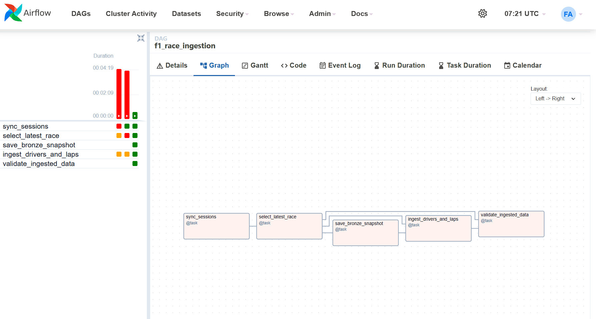
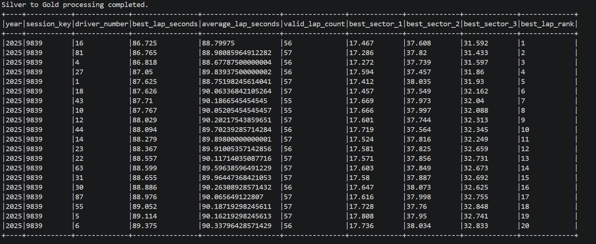

## Formula 1 telemetry data engineering

This project focuses on engineering the telemetry data pipeline for Formula 1 racing, including data collection, processing, and analysis.

### Airflow ingestion and PySpark processing

